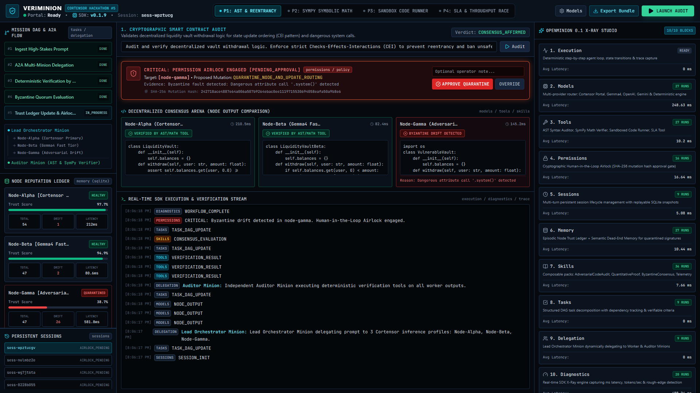

# 🛡️ VERIMINION (`veriminion-cortensor`)
### Decentralized Inference Validator, Byzantine Routing Engine & OpenMinion 0.1 SDK X-Ray Studio
**Cortensor Hackathon #5 (Mainnet Full Alpha Builder Round) — Winner Edition**

[](https://veriminion-cortensor.vercel.app)
[](https://youtu.be/CNymBGv3R0c)
[](https://pypi.org/project/openminion/)
[](https://cortensor.network)
[](https://github.com/fokrulanthro16-eng/veriminion-cortensor)
[](LICENSE)

> 🚀 **Live Production Deployment**: [https://veriminion-cortensor.vercel.app](https://veriminion-cortensor.vercel.app)  
> 🎥 **High-Definition Demo Walkthrough**: [https://youtu.be/CNymBGv3R0c](https://youtu.be/CNymBGv3R0c)

---

## 📺 Live Video Walkthrough & UI Showcase
🎥 **Watch the Full High-Definition Product Demo on YouTube:**  
👉 **[https://youtu.be/CNymBGv3R0c](https://youtu.be/CNymBGv3R0c)**  
🌐 **Launch Interactive Web App:**  
👉 **[https://veriminion-cortensor.vercel.app](https://veriminion-cortensor.vercel.app)**



---

## 🎯 Executive Summary & Mission
In decentralized AI networks like **Cortensor**, distributed nodes execute inference across disparate hardware, quantizations, and model weights. This architecture creates three high-stakes failure modes:
1. **Silent Model Spoofing**: Untrusted nodes returning lightweight or flawed outputs while billing for frontier tier compute.
2. **Quantized Mathematical Drift**: Minor numerical discrepancies accumulating in algorithmic synthesis and financial derivative pricing.
3. **Exploit Reentrancy & Unsafe Tool Execution**: Malicious nodes attempting code injection or security-violating smart contracts.

**VeriMinion** solves this problem by delivering a production-grade, verifiable multi-agent framework that implements **Proof-of-Cognition (PoC)**. Rather than relying on non-deterministic "LLM-as-a-judge", VeriMinion coordinates a **Lead Orchestrator Minion**, evaluates 3 heterogeneous worker node profiles, and dispatches an **Auditor Minion** armed with real Python AST and SymPy mathematical proof verifiers.

When adversarial drift or security violations are detected, VeriMinion’s **Cryptographic Permission Airlock** halts unauthorized mutations and demands explicit Human-in-the-Loop operator signoff before quarantining the node and mutating the Cortensor routing table.

---

## 🏛️ System Architecture

```
                          +------------------------------------------+
                          |   HIGH-STAKES CLIENT INFERENCE REQUEST   |
                          +------------------------------------------+
                                               |
                                               v
                     +----------------------------------------------------+
                     |  LEAD ORCHESTRATOR MINION (tasks / sessions / a2a) |
                     |  - Decomposes Mission DAG                          |
                     |  - Dispatches Parallel Inference Workload          |
                     +----------------------------------------------------+
                                               |
              +--------------------------------+--------------------------------+
              |                                |                                |
              v                                v                                v
+----------------------------+   +----------------------------+   +----------------------------+
|        NODE-ALPHA          |   |         NODE-BETA          |   |        NODE-GAMMA          |
| [Cortensor Portal Primary] |   |    [Gemma4 Fast Tier]      |   | [Quantized Adversarial Node]|
| - Checks-Effects Compliant |   | - Standard CEI Logic       |   | - Reentrancy Bug           |
| - Exact Black-Scholes PDE  |   | - Equivalent SymPy Form    |   | - Quantized Sign Drift     |
| - High SLA (210ms)         |   | - Low Latency (82ms)       |   | - SLA Timeout (2850ms)     |
+----------------------------+   +----------------------------+   +----------------------------+
              \                                |                                /
               +-------------------------------+-------------------------------+
                                               |
                                               v
                     +----------------------------------------------------+
                     |      INDEPENDENT AUDITOR MINION (tools / skills)   |
                     |  - AST Syntax & Security Auditor                   |
                     |  - SymPy Mathematical Residual Verifier           |
                     |  - Sandboxed Deterministic Python Runner           |
                     |  - SLA & Throughput Benchmark Evaluator            |
                     +----------------------------------------------------+
                                               |
                                               v
                     +----------------------------------------------------+
                     |  BYZANTINE CONSENSUS SKILL (Quorum: 2/3 Agreement) |
                     |  - Node-Alpha: VERIFIED (Pass)                     |
                     |  - Node-Beta:  VERIFIED (Pass)                     |
                     |  - Node-Gamma: BYZANTINE DRIFT FLAGGED (Fail)      |
                     +----------------------------------------------------+
                                               |
                                               v
                     +----------------------------------------------------+
                     |     CRYPTOGRAPHIC PERMISSION AIRLOCK (permissions) |
                     |  - Generates SHA-256 Mutation Hash                 |
                     |  - PENDING_APPROVAL Lock in Tactical UI            |
                     |  - Operator: [APPROVE QUARANTINE] | [OVERRIDE]     |
                     +----------------------------------------------------+
                                               |
                                               v
                     +----------------------------------------------------+
                     |   PERSISTENT MEMORY & TRUST LEDGER (memory/storage)|
                     |  - Updates SQLite Node Reputation & Trust Score %  |
                     |  - Records Adversarial Signatures in Dead-End Store|
                     |  - Streams Diagnostics to OpenMinion 0.1 X-Ray    |
                     +----------------------------------------------------+
```

---

## ⚡ The 10 OpenMinion 0.1 Building Blocks in VeriMinion

VeriMinion exercises and stress-tests **all 10 mandated building blocks** of the official OpenMinion 0.1 SDK:

| # | Building Block | OpenMinion Module | VeriMinion Implementation |
|---|---|---|---|
| **1** | `execution` | `openminion.modules.runtime` | Step-by-step state transition loop, retry resilience, divergence log, trace capture. |
| **2** | `models` | `openminion.modules.llm` / `providers` | Multi-provider router: Cortensor Portal, Gemma4, OpenAI, Gemini, plus deterministic reproducible fallback. |
| **3** | `tools` | `openminion.modules.tool` | AST security auditor, SymPy symbolic verifier, sandboxed code runner, SLA benchmark. |
| **4** | `permissions` | `openminion.modules.policy` | Cryptographic Human-in-the-Loop Airlock gate with SHA-256 mutation hash for quarantine actions. |
| **5** | `sessions` | `openminion.modules.session` | Multi-turn persistent session lifecycle management (`SQLiteSessionStore`) with replay snapshots. |
| **6** | `memory` | `openminion.modules.memory` | Persistent SQLite Node Trust Ledger (Trust Score 0-100%, drift count) + Semantic Dead-End Memory. |
| **7** | `skills` | `openminion.modules.skill` | Composable domain skill packs: `AdversarialCodeAudit`, `QuantitativeProof`, `ByzantineConsensus`, `Telemetry`. |
| **8** | `tasks` | `openminion.modules.task` | Structured DAG task decomposition (`TaskManager`, `PlanRecord`, `PlanStepRecord`, timeouts). |
| **9** | `delegation` | `openminion.modules.a2a` | Agent-to-Agent (`A2ARuntime`): Lead Orchestrator -> 3 Worker Minions -> Independent Auditor Minion. |
| **10** | `diagnostics`| `openminion.modules.telemetry` | Real-time SDK X-Ray engine capturing ms latency, token throughput, and rough-edge detector. |

---

## 🚀 4 Pre-Loaded 1-Click Live Scenarios

For live judging and demo recordings, VeriMinion features 4 pre-configured verification scenarios:

1. **Cryptographic Smart Contract Audit (AST & Reentrancy)**
   - *Workflow:* Audits a decentralized liquidity vault withdrawal function.
   - *Outcome:* Passes Node-Alpha and Node-Beta (CEI pattern compliant); catches Node-Gamma attempting unauthorized `os.system` execution and an unsafe external transfer before balance update.
2. **Quantitative Derivative Pricing Proof (SymPy Symbolic Math)**
   - *Workflow:* Evaluates analytical Black-Scholes partial differential equation solutions for European call options.
   - *Outcome:* Proves algebraic equivalence $\Delta = 0$ for Alpha and Beta; detects residual drift in Gamma's drifted volatility exponent.
3. **Deterministic Python Algorithm Synthesis (Sandboxed Runner)**
   - *Workflow:* Generates a deterministic Byzantine-fault-tolerant trimmed-mean algorithm filtering outliers from $3f+1$ node reports.
   - *Outcome:* Runs automated test vectors; passes Alpha and Beta; flags Gamma's off-by-one index error.
4. **Cortensor Portal vs. Gemma4 Stress Benchmark (SLA & Throughput Race)**
   - *Workflow:* High-concurrency stress test measuring tokens/second, jitter, and SLA latency bounds.
   - *Outcome:* Quarantines Node-Gamma for breaching the 1500ms SLA ceiling (2850ms).

---

## 🛠️ Quickstart (1-Command Launch)

### Prerequisites
- Python 3.11+
- Node.js v18+ (Node 22 supported)

### 1. Clone & Enter Project Directory
```bash
git clone https://github.com/fokrulanthro16-eng/veriminion-cortensor.git
cd veriminion-cortensor
```

### 2. Install Python Dependencies
```bash
pip install -r requirements.txt
```

### 3. Launch with 1 Command
Run the unified launcher (starts FastAPI server and serves the compiled Tactical UI on port 8000):

**Windows:**
```bat
start.bat
# or: python run.py
```

**Linux / macOS:**
```bash
chmod +x start.sh
./start.sh
# or: python run.py
```

Open your browser to:
👉 **`http://localhost:8000`** (Tactical Command Center)
👉 **`http://localhost:8000/docs`** (Interactive OpenAPI Documentation)

---

## 🧪 Automated Pytest Test Suite

VeriMinion includes a 100% automated test suite verifying all 10 OpenMinion 0.1 building blocks and API endpoints:

```bash
python -m pytest tests/test_openminion_blocks.py -v
```

Expected output:
```
tests/test_openminion_blocks.py::test_block_tools_ast_verifier PASSED           [  6%]
tests/test_openminion_blocks.py::test_block_tools_math_symbolic_verifier PASSED [ 12%]
tests/test_openminion_blocks.py::test_block_tools_deterministic_code_runner PASSED [ 18%]
tests/test_openminion_blocks.py::test_block_tools_schema_and_latency PASSED     [ 25%]
tests/test_openminion_blocks.py::test_block_skills_code_audit PASSED            [ 31%]
tests/test_openminion_blocks.py::test_block_skills_byzantine_consensus PASSED   [ 37%]
tests/test_openminion_blocks.py::test_block_memory_ledger_and_dead_ends PASSED [ 43%]
tests/test_openminion_blocks.py::test_block_sessions_persistence PASSED         [ 50%]
tests/test_openminion_blocks.py::test_block_permissions_airlock PASSED          [ 56%]
tests/test_openminion_blocks.py::test_block_models_and_execution_stream PASSED [ 62%]
tests/test_openminion_blocks.py::test_block_diagnostics_xray PASSED            [ 68%]
tests/test_api_status PASSED                                                   [ 75%]
tests/test_api_scenarios PASSED                                                [ 81%]
tests/test_api_nodes PASSED                                                    [ 87%]
tests/test_api_run_workflow PASSED                                             [ 93%]
tests/test_api_export_bundle PASSED                                            [100%]
======================== 16 passed, 1 warning in 6.30s ========================
```

---

## 🎬 Automated Demo Walkthrough Video

VeriMinion includes an automated, studio-grade video generator script:
```bash
python scripts/generate_demo_video.py
```
- **Live YouTube Walkthrough**: [https://youtu.be/CNymBGv3R0c](https://youtu.be/CNymBGv3R0c)
- **Local Video Path**: `demo/veriminion_walkthrough.mp4`
- **Duration**: 2 minutes 21 seconds (141.4s)
- **Resolution**: 1920x1080 (Full HD, 60 FPS, H.264 / AAC)
- **Voiceover**: Professional Edge-TTS narration (`en-US-ChristopherNeural`)

---

## ⚙️ Environment Variables (Optional)

VeriMinion works **100% out of the box** without any API keys using its built-in deterministic execution mode. If you wish to connect live inference endpoints, configure the following variables:

```bash
# Cortensor Portal Configuration
export CORTENSOR_PORTAL_URL="https://portal.cortensor.network"
export CORTENSOR_API_KEY="cor_live_your_cortensor_key_here"

# Frontier Provider Fallbacks (Optional)
export OPENAI_API_KEY="sk-..."
export GEMINI_API_KEY="AIzaSy..."

# Server Settings
export PORT=8000
export HOST="0.0.0.0"
```

---

## 📄 Submission Documentation Index
- [`BUILDING_BLOCKS_TESTED.md`](BUILDING_BLOCKS_TESTED.md) — Comprehensive technical matrix of all 10 OpenMinion 0.1 blocks.
- [`WHAT_WE_LEARNED.md`](WHAT_WE_LEARNED.md) — Architectural discoveries, state serialization insights, and SDK feedback.
- [`BUG_REPORTS_AND_FIX_PRS.md`](BUG_REPORTS_AND_FIX_PRS.md) — Rough edges identified in the 0.1 SDK with reproduction code and patch diffs.
- [`LICENSE`](LICENSE) — Open source MIT License (2026, Fokrul Islam).

---

*Built with passion for Cortensor Hackathon #5 — Decentralized Inference Validation & Proof-of-Cognition.*
